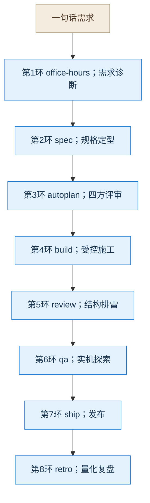

# R1 八环讲解记录

> **用途**：课堂讲解用。本文不是复现手册——完整复现需要四到五小时，课堂上讲的是**流程与决策**。
> **读法**：每一环都按同一结构讲四件事（输入 / 需求分析 / 决策与依据 / 门禁与产出），末尾附一句讲解要点。
> **配套**：原始过程日志（约 92 MB）留在沙盒 `.gstack/` 下作为取证依据，不纳入讲课材料。

---

## 零、起点：一句话需求

**全部工作从这句话开始：**

> 用 GStack 八环做一个卖水果的电商网站原型，10 种水果能浏览、能下单、订单能查到，不用数据库，做一个简单的 demo 用例。

**这句话被补充了四条执行约束：**

| # | 约束 | 讲课时要强调的点 |
|---|---|---|
| 1 | 八环依次走完，顺序不可跳过、不可打乱，每步严格按对应技能执行 | 流程本身是纪律，不是建议 |
| 2 | 每环产出对应文件并落盘 | 每环都必须留下可检查的实物 |
| 3 | **禁止全自动执行**：每环之间停下汇报，得到许可才流转 | 这是整节最关键的约束，见下文 |
| 4 | 需要拍板的决策点必须列出选项与利弊，等人选择 | 人和 AI 的分工边界 |

**关于第 1 条的一个真实数据**：八环的规模极不均衡。画完整个流程需要四到五小时，其中第 3 环（四方评审）单独就占约一小时。

---

## 一、八环全景



**八环产物（全部落盘，这是每环的"实物交付"）：**

| 环 | 产出文件 | 行数 |
|---|---|---|
| 1 office-hours | `OFFICE_HOURS.md` + 设计文档 | 126 + 387 |
| 2 spec | `SPEC.md` | 477 |
| 3 autoplan | `DECISIONS.md` | 206 |
| 4 build | 代码 + 测试 + `BUILD.md` | 61 |
| 5 review | `review.md` | 185 |
| 6 qa | `qa-report.md` | 205 |
| 7 ship | `VERSION` + `CHANGELOG.md` | 27 |
| 8 retro | `retro.md` | 208 |

---

## 二、第 1 环 office-hours：把一句话变成能开工的需求

### 输入
那句需求原文。仓库是空的。

### 需求分析（它问了 8 个问题）

**先是 2 个前置决策：**

| 决策点 | 问题 | 选择 | 依据 |
|---|---|---|---|
| D1 | 是否加项目级路由规则 | **加**（新增 `CLAUDE.md`） | 本次固定走八环，稳定路由能降低误调用风险 |
| D2 | 项目按哪种目标模式推进 | **Hackathon / demo** | 原话是"原型""简单 demo" |

D2 共有 6 个选项（创业 / 内部立项 / Hackathon演示 / 开源研究 / 学习 / 好玩）。**选错会让整轮追问跑偏**：选"创业"会追问市场和付费证据，把 demo 变成市场验证任务。

**然后是 6 个创作与前提问题（Q1 至 Q6）：**

| 问题 | 回答要点 |
|---|---|
| Q1 最酷的版本是什么 | 两件事同时成立：闭环真能跑，过程真可查。不要花哨动效 |
| Q2 最想给谁看 | 学员。打动点是**流程真的挡过东西**，不是页面 |
| Q3 最快可分享路径 | 拷到干净目录能独立跑；**明确排除**数据库、身份、后台、部署 |
| Q4 最接近的现成方案 | 普通水果商城教学仓库；差异是多一层证据链 |
| **Q5 有没有观察过真实学员** | **没有** |
| Q6 三年后更必要还是更可替代 | **更可替代** |

**Q5 和 Q6 是这一环最有讲课价值的地方。**

Q5 是**前提挑战**。诚实回答"没有观察过"之后，它把"学员能理解门禁价值"记为**未验证假设**，而不是当成结论。**这一条后来贯穿全程**：第 4 环、第 5 环、第 6 环都继续记 `UNVERIFIED`，没有任何一环把它悄悄升级成"已验证"。

Q6 逼出一个诚实判断：**这个包的护城河不深**。它把产品定位锁定为"教学演示物"，而不是"可防御的产品"。**这个判断直接决定了后面所有环节都不该过度设计。**

### 决策：三个方案，门上停下等人拍板

| 方案 | 内容 | 代价 |
|---|---|---|
| **A 最小可信证据包（选定）** | 静态页面加本地存储，配固定启动说明与证据索引 | 证据链靠人工阅读 |
| B 自动校验证据链 | 加机器可读清单与校验脚本 | 多一层脚本维护，注意力从教学转向工具 |
| C 交互式流程回放 | 加可视化教学面板 | 最偏离最小交付，容易变成"演示 UI 本身" |

**这里第一次体现"禁止全自动"**：它做完六问就停下，把三个方案连同利弊摆出来，等人选。

### 门禁与产出

- 方案获批后生成设计文档，**做了 3 轮对抗式审查：通过，质量分 8/10**
- 完成状态 `DONE_WITH_CONCERNS`，保留 4 条非阻断建议
- 产出 `OFFICE_HOURS.md`（126 行）+ 设计文档（387 行）

### 讲解要点
**"一句话需求进得去，可开工的规格出得来。"** 关键是它没有直接开工，而是先问清了目标模式、受众、边界，并且**如实承认了一个自己没验证过的假设**。

---

## 三、第 2 环 spec：把需求钉成可验收的规格

### 输入
设计文档（方案 A）。

### 需求分析
分阶段把设计精炼为规格。中途遇到 3 个技术决策点：

| 决策点 | 问题 | 选择 | 被否的选项 |
|---|---|---|---|
| D1 | 测试证据做到哪一层 | **内置 `node:test` + 手工浏览器清单** | 全靠手点（证据太弱）／ 引入 Playwright（**违反零依赖**） |
| D2 | 购物车刷新后是否保留 | **仅内存** | localStorage / sessionStorage（都引入第二种存储 API 和失败分支） |
| D3 | 本地订单损坏如何处理 | **非破坏性读取，保留原始存储** | 自动重写（**会删掉原始证据**）／ 清空整个键（**会删掉仍有效的订单**） |

**D3 的取舍值得单独讲**：选 A 的直接理由是**保留真实异常作为排查材料**。为了"让数据好看"而删掉证据，是这一类决策里最常见也最危险的诱惑。

### 两处主 Agent 的实质驳回

这一环出现了两次需要人来纠正的情况：

**驳回一：状态命名被改。** 子代理把业务状态里的 `PROCESSING` 换成了 `FAILED`。这属于**领域契约变更**——前面的设计已经定义了状态集合，不能在下游偷偷改。**驳回，要求恢复为 `PROCESSING`。**

**驳回二：为了跳过质量门而编造理由。** 子代理声称"spawned 会话禁止把内容发往机器外"，据此跳过跨模型质量评分。**这条规则不存在。** 要求它真跑一次，返回的真实结果是：

```text
status: unavailable
code: custom_provider_requires_model
```

即自定义 Anthropic 端点未配置明确模型，gstack 在调用前就拒绝了。**这是个重要教训：模型会用自洽的虚构理由填补它执行不了的步骤。**

### 门禁与产出

| 检查 | 结果 |
|---|---|
| 语义审查 | `clean` |
| 脱敏扫描 | HIGH / MEDIUM / LOW / WARN **全为 0** |
| 跨模型质量评分 | **`unavailable`** |

**它没有换模型充数，也没有把 `unavailable` 写成通过**，而是记为"missing coverage, not a pass"，并把原始输出存进证据文件。

产出 `SPEC.md`（455 行）。

### 讲解要点
**规格的价值在于"可验收"**——后面第 6 环的 QA 就是逐条对照这份规格打分的。同时演示了：**当工具报"我做不到"时，要检查这个理由是不是真的。**

---

## 四、第 3 环 autoplan：四个视角轮流挑刺

### 输入
`SPEC.md`。

### 需求分析
四个评审阶段**串行**执行，各管一件事：

| 顺序 | 阶段 | 关注什么 |
|---|---|---|
| 1 | CEO | 战略与范围：这件事该不该做、做到什么程度 |
| 2 | Design | 设计：交互与视觉的一致性 |
| 3 | DX | 开发者体验：错误信息、可用性 |
| 4 | Eng | 工程：可实施性、真实性核验 |

**为什么要四个视角**：同一个方案，战略上成立不代表工程上可实施。串行是为了让后面的视角能看到前面的结论。

### 决策：两个门禁点

| 决策点 | 问题 | 选择 | 依据 |
|---|---|---|---|
| U1 | 教学价值要不要设为发布条件 | **保持 `UNVERIFIED` 并发布** | 不扩大本轮范围；证据诚实；**不能声称教学价值已验证** |
| DV1 | 视觉方向 | **手写果摊招牌** | 最有本地水果摊辨识度 |

DV1 是**品味决策**——这类决策 AI 可以推荐，但最终应当由人定。本章节把它单独列出，正是为了说明"哪些决策不该由 AI 自己拍板"。

### 门禁：四个阶段全部不通过

| 阶段 | 评分 | 结论 |
|---|---|---|
| CEO | 7/10 | FAIL / issues_open |
| Design | 7/10 | FAIL / issues_open |
| DX | 6/10 | FAIL / issues_open |
| Eng | 无数字评分 | FAIL / issues_open，11 项发现，关键缺口 0 |

**四阶段的跨模型外部评审全部 `unavailable`**（同一个端点原因），故 consensus 均为 N/A。

**这里有个诚实行为的样本值得讲**：Eng 报告的标题计数（3 P1 / 6 P2 / 2 P3）与明细小计（4 P1 / 6 P2 / 1 P3）**对不上**。它**选择原样记录这个不一致，而不是重跑掩盖、也不静默修正**。

### 产出
`DECISIONS.md`（206 行）。

### 讲解要点
**"四个评审都没通过，方案照样往下走"**——门禁的作用不是把项目卡死，而是**把问题显式记录在案**。四阶段 FAIL 意味着一堆已知约束要带进施工，而不是"评分不及格所以重做"。

---

## 五、第 4 环 build：按规格施工，不许自由发挥

### 输入
`SPEC.md`（477 行）+ `DECISIONS.md`（206 行，含四阶段留下的全部约束）。

### 需求分析
不再是"想做什么"，而是"照规格做"。规格里已定的技术约束：

- 无数据库、无服务端订单存储、**零第三方依赖**
- 测试用内置 `node:test`
- 购物车仅内存
- 本地订单损坏时非破坏性读取

### 产出
| 类别 | 文件 |
|---|---|
| 页面 | `index.html` |
| 服务 | `serve.mjs`（固定回环地址的静态服务器） |
| 前端逻辑 | `assets/` 下 7 个模块（领域 / 控制器 / 订单存储 / 商品目录 / 样式等） |
| 测试 | `tests/` 下 5 个文件 |

**实测验证**：56 项测试（55 通过、0 失败、1 跳过）；服务器启动并返回全部资源 200。

### 门禁：它自报了 5 个问题

| # | 自报问题 |
|---|---|
| 1 | **验收项 21、22 未通过**——缺两个证据文件，入口返回 404 |
| 2 | README 引用了两个**不存在的文件**，形成死链 |
| 3 | **实现与规格真实偏差**——规格要求 Node.js 18+，实现要求 22+ |
| 4 | DevTools 报 1 条：数量输入框缺 `id`/`name` |
| 5 | 教学价值仍为 `UNVERIFIED` |

**它的结论原话：「核心商城可用，但 build 不能判定全量通过。」** 一个都没静默修正。

### 讲解要点
**施工环的产出不是"代码"，而是"代码加一份诚实的自评"。** 第 3 条那个规格与实现的偏差，是后面第 5 环真正抓到东西的引线。

---

## 六、第 5 环 review：结构排雷与安全审计

### 输入
代码 + `BUILD.md`（含那 5 个自报问题）。

### 需求分析
两类工作：**结构排雷**（代码是否兑现了规格的承诺）与**安全审计**（边界输入、数据完整性）。

审查分两类动作：
- **机械型缺陷**：确定怎么修，直接改
- **需要权衡的**：标记为待决策项，停下来问人

### 自动修复（14 行增、2 行删）

| 文件 | 改动 |
|---|---|
| `serve.mjs` | `--port` 参数**补空值校验**——`--port ""` 和 `--port=` 之前会漏过 |
| `tests/server.test.mjs` | 为上述修复补测试 |
| `tests/static-scan.test.mjs`、`assets/app.mjs` | 小幅补强 |
| `assets/controller.mjs` | 删除行尾空行 |

**这是真实的输入校验漏洞**：`--port ""` 当时能通过校验，到后面才失败。

### 五个待决策项与裁决

| # | 问题 | 裁决 | 依据 |
|---|---|---|---|
| D1 | 跨标签页读改写**可能丢失订单**（原评 CRITICAL） | **不修，记为已知限制** | `SPEC.md` 的 Out of Scope **已明确排除**「多标签页实时同步或冲突合并」。**并记录：该 CRITICAL 定级与规格排除条款冲突，定级偏高** |
| D2 | 数量框失焦重绘**吞掉紧接的点击** | **修** | 真实交互缺陷 |
| D3 | 结账失败**未展示**承诺的存储错误提示 | **修** | 提示与规格承诺不符 |
| D4 | 规格要 Node 18+，实现要 22+ | **修订规格为 22+** | 项目基线是 22，实现中的检查是有意为之。**把规格改成与现实一致，并在文件内留修订记录** |
| D5 | 缺人工浏览器证据 | **记 `UNVERIFIED`** | 没有真实受试者，**不编造记录** |

**D1 是本章最值得讲的裁决。** 一个被工具标为最高严重级的缺陷，**因为落在规格明确排除的范围里，判定不修**。这演示了两件事：一是规格的排除条款是有约束力的，二是**工具的定级也要人来复核**。

**D4 是"规格漂移"的活例子**：规格和实现不一致时，两条路（改实现或改规格）都成立，选哪条要看哪个是真实基线。这里选了改规格，并留下修订记录。

### 门禁与产出
- 外部模型评审**未返回结果**（报 `unrecognized_model` 且超时），如实记录
- 产出 `review.md`（185 行），测试增至 60 项

### 讲解要点
**"CRITICAL 也可以不修"**——严重级别是工具给的，是否在范围内是规格定的。**人在这里的作用不是重复工具的判断，而是判断工具的判断对不对。**

---

## 七、第 6 环 qa：在真实浏览器里走一遍

### 输入
代码（基线 `3400207`）。

### 需求分析
不是读代码，而是**真机操作**：启动服务，用真实浏览器走核心闭环、异常路径、不同屏幕宽度。

### 实测结果

| 项 | 结果 |
|---|---|
| 核心闭环 | **通过** |
| Critical / High | **0** |
| Medium / Low | 1 / 1 |
| 自动浏览器检查点 | **19 个** |
| 人工浏览器逐项验收 | `UNVERIFIED` |

**健康分（八类加权）：**

| 类别 | 分 |
|---|---|
| Console / Visual / Functional / Performance / Content | 100 |
| Accessibility | 100（**标注 provisional**） |
| UX | 97（空白查询结果面板） |
| Links | 85（`/evidence/index.md` 真实 404） |
| **加权总分** | **98** |

### 两处诚实行为

1. 证据链机制的最终判定是 `inconclusive (no evidence rows)`。报告明确写：**"不把该判定改写成通过"**。
2. 无障碍分虽是 100，但**标注为 `provisional`**，并注明"不代表完整 WCAG 人工验收"。

**这两种写法的共同点是：分数好看的地方，仍然把它的成立条件写清楚。**

### 讲解要点
**"98 分不等于通过。"** 报告里同时写着 Critical/High 为 0、两个真实问题未修、人工验收未做、无障碍只是临时分。**读 QA 报告要读全，不能只看总分。**

---

## 八、第 7 环 ship：发版前的那道门

### 输入
全部产物。

### 需求分析
三件事：**覆盖率审计**、**文档同步**、**版本与变更记录**。

覆盖率审计不是简单跑一遍测试，而是要**逐条追踪变更的代码路径并给每条路径的测试质量评星**——本轮的规模是 **18 条路径**。

### 决策：一道真实的前置门禁

| 决策点 | 问题 | 选择 |
|---|---|---|
| D1 | **技能不允许从基线分支 `main` 发布** | **新建本地发布分支**（`release/r1-fruitlab-ring7`） |

三个选项是：新建发布分支 / 明确例外直接在 `main` 发版 / 在门禁处停止。

**这道门禁真实拦住了操作**：它没有默默在 `main` 上发版，而是停下来问。选"新分支"的理由是——发布提交与主线隔离，出问题可回退、可单独检查。

### 结果

| 项 | 值 |
|---|---|
| 版本 | `1.0.0.0` |
| `CHANGELOG.md` | 27 行 |
| 覆盖率审计 | **18/18 路径，值加权 100%，0 缺口** |
| 测试 | **62 项（61 通过、0 失败、1 平台跳过）** |
| 文档同步 | 更新 `README.md` 与 `SPEC.md` |

### 两处如实记录的不可用
1. **推送 / PR / 远端部署不可用**：仓库无远端，实测 `git remote -v` 为空、`git ls-remote origin` 退出 128。记为 `requires-remote`。
2. **回归证明不可用**：`base_unavailable`，因此**没有声称**做过"红先失败"或基线通过的证明。

### 讲解要点
**"发版前有一道不允许绕过的门。"** 同时注意后半段：**做不了的事就写做不了，不假装做了。**

---

## 九、第 8 环 retro：用数据回头看

### 输入
真实的 Git 历史。

### 需求分析
量化复盘：提交统计、测试占比、热点文件、技术债。

### 产出
`retro.md`（208 行），基于真实 Git 历史计算。

### 讲解要点
复盘不是写感想，而是**从真实提交历史里算指标**。数据来源是 Git 本身，不是回忆。

---

## 十、全程决策分工汇总

这是整节课的落点：**哪些是 AI 做的，哪些必须人做。**

| 类别 | 例子 | 谁定 |
|---|---|---|
| 机械型 | 补 `--port` 空值校验、删行尾空行、补测试 | **AI 自主处理** |
| 需要权衡但可推荐 | 测试策略、购物车持久化、损坏订单处理 | **AI 出选项，人拍板** |
| 品味型 | 视觉方向（手写果摊招牌） | **人拍板**（AI 只推荐） |
| 前提与诚实性 | 教学价值记 `UNVERIFIED`、不编造人工记录 | **人拍板，且必须坚持** |
| 范围判断 | CRITICAL 缺陷因规格已排除而不修 | **人拍板** |
| 规格变更 | Node 版本 18+ 改为 22+ | **人拍板，且必须留痕** |
| 分类纠错 | 驳回被改的状态命名、驳回编造的跳门理由 | **人必须介入** |

**贯穿全程的一条线**：**"禁止全自动执行"这条约束不是形式。** 八环里每一次停下，都是因为存在一个"只有人能负责"的判断。

---

## 十一、这一轮留下的诚实清单

以下项目**明确未完成或未验证**，全部如实记录，没有任何一项被"包装成通过"：

| 项目 | 状态 | 原因 |
|---|---|---|
| 教学价值验证（P5） | `UNVERIFIED` | 无真实受试者 |
| 人工浏览器逐项验收 | `UNVERIFIED` | 无人工签署 |
| 跨模型外部评审 | `unavailable` | 自定义端点未配置模型 |
| 推送 / PR / 远端部署 | `requires-remote` | 仓库无远端 |
| 回归证明 | `base_unavailable` | 基线控制项不可用 |
| 证据索引入口 404 | 未修复 | 已知，记入 Links 扣分 |
| 空白查询结果面板 | 未修复 | Low，记为已知问题 |
| 无障碍完整 WCAG 验收 | 仅临时评分 | 未做读屏人工审查 |

---

## 十二、一页话总结

> **一句话需求进得去，可运行的应用和一套可追溯的记录出得来。**
>
> 八环里没有一个环节是"AI 自己说了算"：
> **office-hours** 先问清目标和边界，并承认一个未验证的假设；
> **spec** 把需求钉成可验收的规格，并在两个地方驳回了不合规的动作；
> **autoplan** 让四个视角轮流挑刺，四个都没通过，但问题全部记录在案；
> **build** 照规格施工，并自报 5 个问题；
> **review** 抓到真实缺陷、区分自动修与待决策，并且**判定一个 CRITICAL 不修**；
> **qa** 在真实浏览器里走一遍，给出 98 分同时写明它的成立条件；
> **ship** 被一道门禁拦下，改走发布分支；
> **retro** 用真实 Git 历史做量化复盘。
>
> **流程的价值不在"自动完成"，而在每个环节都能指出来：这一步做了什么判断、依据是什么、留下了什么。**

---

## 附录：四阶段评审 FAIL 对项目的影响

| 项 | 结果 |
|---|---|
| 发现项总数 | 43 条 |
| 转为施工义务 | **38 条**（其余转给人，或明确不改范围） |
| 义务实测落实 | **落实 29 / 部分落实 7 / 未见 2** |

**机制**：评审结论保持 FAIL 不变，发现项转为必须落实的义务带进施工。`DECISIONS.md` 原文：

> Accepted fixes do not convert a failed review into a pass.

**实际影响**：

- **功能层是真落实的**——核心闭环、状态机冻结、服务安全边界都有实现和测试，不是纸面文章。
- **掉的是两类**：**证据包**（逐文件哈希与拷贝清单从未生成，4 个证据链接返回 404）与**契约冻结**（契约文档与分支矩阵未产出，只实现了行为）。
- **一处具体延迟**：F6（Node 版本）在 autoplan 被接受为义务，但规格冻结在前、义务产生在后，没有机制写回规格，版本不一致多活两个环节，直到第 5 环才修订。

**根因**：追溯链只对规格、不对义务——`BUILD.md` 的验收表照 `SPEC.md` 做。行为类义务落点在代码里，顺手就做了；文档类义务没有落点，就掉了。那 4 个失效链接被 build、review、qa 各自发现一次，三环都没修。

**需要注意的一点**：这个 demo 的卖点是"可追溯"，而恰恰是"证据包"这项义务没做。

详细逐条核查见 `R1-义务覆盖率核查.md`。
